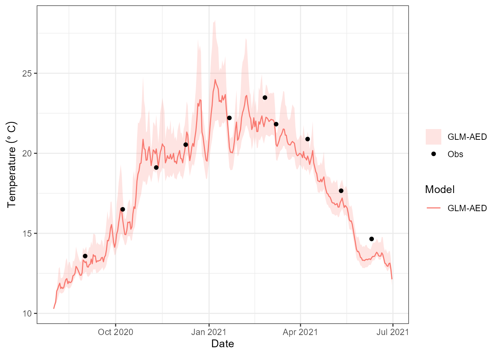
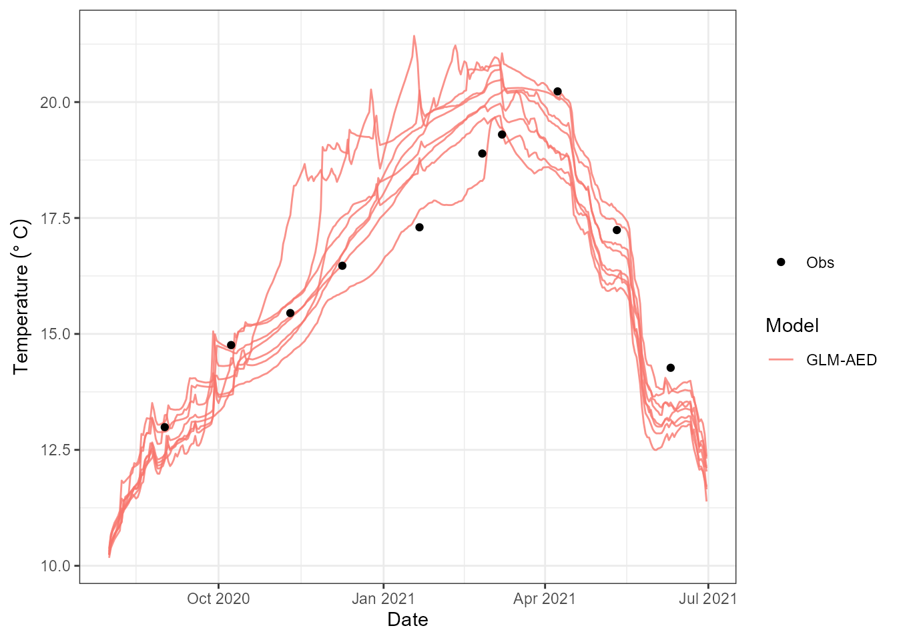
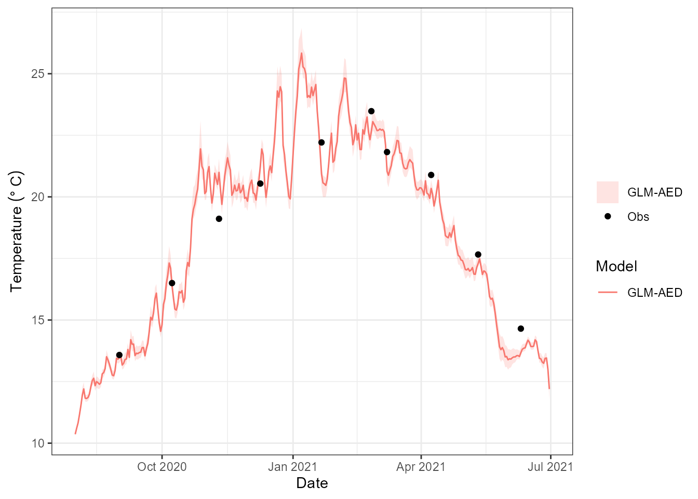
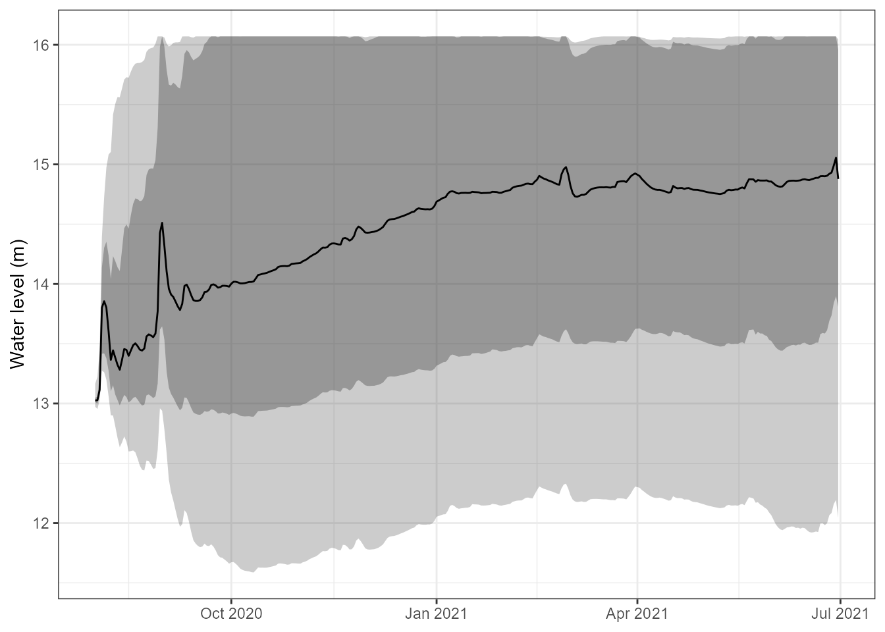
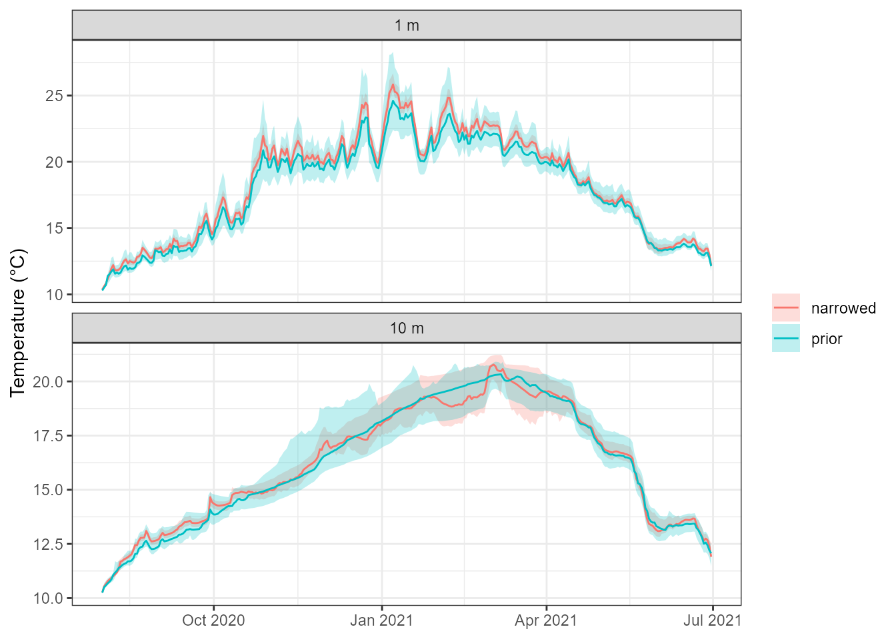

# Parameter uncertainty with ensembles

## Why parameter uncertainty matters

A single calibrated run gives one trajectory per variable, and it looks
far more certain than it is. Many process parameters – light extinction,
mixing coefficients, inflow and outflow scaling, the biogeochemical rate
constants – are only loosely constrained by the data we have. Several
quite different parameter vectors can reproduce the observed temperature
profile equally well and then diverge when asked about oxygen, or about
a season that was not observed.

Running the model over an **ensemble of parameter sets** makes that
visible. The spread across members is a direct, model-based estimate of
how much of the prediction is controlled by what we do not know about
the parameters. It is one axis of uncertainty alongside the initial
state (see `vignette("initial-conditions-and-spin-up")`) and the
forcing.

This article covers three things:

1.  **running an ensemble** with
    [`run_aeme_ensemble()`](https://limnotrack.com/AEME/reference/run_aeme_ensemble.md),
    here with parameter sets sampled from each parameter’s `[min, max]`
    range;
2.  **supplying calibrated sets** – in particular the posterior from a
    PEST++ iterative ensemble smoother calibration;
3.  **writing the output to Parquet**, so a large ensemble can be stored
    compactly, queried without loading it all, and compared with other
    ensembles later.

``` r

library(AEME)
library(dplyr)
library(ggplot2)

options(AEME.inform = FALSE)
```

We use the example lake shipped with the package, simulated with
GLM-AED. Copy its configuration somewhere writable, load it, and build
the model once:

``` r

tmpdir <- tempdir()
path <- file.path(tmpdir, "lake")

aeme_file <- system.file("extdata/aeme.rds", package = "AEME")
aeme <- readRDS(aeme_file)
```

## The parameter table

An ensemble needs something to vary. AEME describes calibratable
parameters in a long data.frame with one row per parameter: the `model`
and `file` it lives in, its `name`, a current `value`, and the `min` and
`max` that bound it. The package ships a ready-made table:

``` r

data("aeme_parameters", package = "AEME")
param <- aeme_parameters[aeme_parameters$model == "glm_aed", ]
as.data.frame(param[, c("file", "name", "value", "min", "max")])
#>        file                  name value min  max
#> 1  glm3.nml              light/Kw  0.58 0.1 5.52
#> 2  glm3.nml  mixing/coef_mix_conv  0.14 0.1 0.20
#> 3  glm3.nml   mixing/coef_mix_hyp  0.74 0.4 0.80
#> 4  glm3.nml mixing/coef_mix_shear  0.14 0.1 0.20
#> 5  glm3.nml  mixing/coef_mix_turb  0.56 0.2 0.70
#> 6  glm3.nml mixing/coef_wind_stir  0.21 0.2 0.30
#> 7       inf                inflow  1.00 0.5 2.50
#> 8       met            MET_radswd  1.00 0.7 1.30
#> 9       met            MET_wndspd  1.00 0.7 1.30
#> 10      wdr               outflow  1.00 0.5 2.50
```

The example lake has no parameters attached, so we attach the table to
the `aeme` object with
[`add_param()`](https://limnotrack.com/AEME/reference/add_param.md). The
`min`/`max` columns are the sampling space, so this is the place to
encode what you believe about each parameter. The shipped `Kw` range
(light extinction) runs from 0.1 to 5.5 m⁻¹, which spans everything from
clear alpine water to a bloom; for this lake we narrow it:

``` r

param$max[param$name == "light/Kw"] <- 1.5
aeme <- add_param(aeme, param)
```

Then build the GLM-AED configuration:

``` r

aeme <- build_aeme(aeme, model = "glm_aed", path = path, ext_elev = 3)
```

## A sampled ensemble

[`run_aeme_ensemble()`](https://limnotrack.com/AEME/reference/run_aeme_ensemble.md)
runs a model once per **parameter set** you give it. For each member it
writes the parameters into the model configuration with
[`input_model_parameters()`](https://limnotrack.com/AEME/reference/input_model_parameters.md)
and then calls
[`run_aeme()`](https://limnotrack.com/AEME/reference/run_aeme.md), and
it stores every member’s output on the returned object under
`output(aeme)$ens_001 ... ens_00k`. A member that fails is dropped, with
a warning, and the rest are renumbered.

`param_sets` is either

- a **list of parameter data.frames**, one per member, each with the
  `value` column set; or
- a single **long data.frame** with an `ensemble` id column plus the
  usual parameter columns.

Each data.frame has the same columns as `parameters(aeme)`; only
`model`, `file`, `name` and `value` are required.

The simplest ensemble draws each parameter independently and uniformly
between its `min` and `max`. That is a few lines of R, so we write it
ourselves:

``` r

sample_param_sets <- function(param, n) {
  sets <- lapply(seq_len(n), function(i) {
    p <- param
    p$value <- runif(nrow(p), p$min, p$max)
    p
  })
  setNames(sets, sprintf("m%02d", seq_len(n)))
}

set.seed(42)
param_sets_prior <- sample_param_sets(parameters(aeme), n = 12)
head(param_sets_prior[[1]][, c("name", "value", "min", "max")])
#>                    name     value min max
#> 1              light/Kw 1.3807285 0.1 1.5
#> 2  mixing/coef_mix_conv 0.1937075 0.1 0.2
#> 3   mixing/coef_mix_hyp 0.5144558 0.4 0.8
#> 4 mixing/coef_mix_shear 0.1830448 0.1 0.2
#> 5  mixing/coef_mix_turb 0.5208728 0.2 0.7
#> 6 mixing/coef_wind_stir 0.2519096 0.2 0.3
```

Then run them:

``` r

aeme_prior <- run_aeme_ensemble(aeme, model = "glm_aed", path = path,
                                 param_sets = param_sets_prior)
#> Warning: 4 of 12 ensemble members failed or ended early and were dropped.
#> ℹ Dropped: "m03", "m04", "m10", and "m12".
output(aeme_prior)$n_members
#> [1] 8
```

Each parameter is sampled **independently**, so there is no correlation
structure between parameters, and every member is a complete model run.
Swap in a normal distribution, a Latin hypercube or anything else by
changing how `value` is filled –
[`run_aeme_ensemble()`](https://limnotrack.com/AEME/reference/run_aeme_ensemble.md)
only sees the finished sets.

Members are independent, so they parallelise cleanly. Set
`parallel = TRUE` (and optionally `ncore`) to run them on several cores,
each worker in its own copy of the model directory:

``` r

param_sets_prior <- sample_param_sets(parameters(aeme), n = 100)
aeme_prior <- run_aeme_ensemble(aeme, model = "glm_aed", path = path,
                                 param_sets = param_sets_prior,
                                      parallel = TRUE, ncore = 4)
```

### Members that fail

Some combinations of parameters are simply unphysical for a lake – for
example an outflow scaling that drains the lake faster than the inflow
fills it. GLM does not report that as an error: it exits normally, the
water level goes to zero and below, and the rest of the output is `NA`.
[`run_aeme_ensemble()`](https://limnotrack.com/AEME/reference/run_aeme_ensemble.md)
therefore checks each member’s water level and, by default
(`drop_incomplete = TRUE`), drops any member whose level reaches zero or
goes `NA`, as well as any that error or produce no output. The warning
above names the members dropped, and the survivors are renumbered
`ens_001`, `ens_002`, …

Because the sets were named, the labels of the survivors are kept:

``` r

kept <- attr(output(aeme_prior), "realisation")
kept
#> [1] "m01" "m02" "m05" "m06" "m07" "m08" "m09" "m11"
setdiff(names(param_sets_prior), kept)
#> [1] "m03" "m04" "m10" "m12"
```

Comparing the dropped members’ parameters with the survivors’ shows what
went wrong. Here the inflow and outflow scalings are the usual culprits:

``` r

bind_rows(param_sets_prior, .id = "member") |>
  filter(name %in% c("inflow", "outflow")) |>
  mutate(status = ifelse(member %in% kept, "kept", "dropped")) |>
  tidyr::pivot_wider(id_cols = c(member, status), names_from = name,
                     values_from = value) |>
  arrange(status, member)
#> # A tibble: 12 × 4
#>    member status  inflow outflow
#>    <chr>  <chr>    <dbl>   <dbl>
#>  1 m03    dropped  1.28    2.17 
#>  2 m04    dropped  0.515   1.72 
#>  3 m10    dropped  1.17    1.74 
#>  4 m12    dropped  0.503   2.16 
#>  5 m01    kept     1.97    1.91 
#>  6 m02    kept     2.46    1.62 
#>  7 m05    kept     2.28    1.74 
#>  8 m06    kept     1.85    1.53 
#>  9 m07    kept     1.04    0.981
#> 10 m08    kept     0.516   0.503
#> 11 m09    kept     0.967   1.11 
#> 12 m11    kept     1.98    0.505
```

Set `drop_incomplete = FALSE` to keep every member, `NA`-padded after
the model stopped, if you want to inspect them. A tight parameter range,
or a supplied ensemble that has already been through a calibration, is
the best way to avoid failures in the first place.

### Summarising and plotting

[`plot_ensemble()`](https://limnotrack.com/AEME/reference/plot_ensemble.md)
shows the central interval of the ensemble as a ribbon, with the lake
observations overlaid, for one variable and depth:

``` r

plot_ensemble(aeme_prior, model = "glm_aed", var_sim = "HYD_temp", depth = 1,
              conf_int = 0.95)
```



`type = "line"` draws one line per member instead, which is useful for
seeing whether the spread comes from a few outlying members or from the
ensemble as a whole:

``` r

plot_ensemble(aeme_prior, model = "glm_aed", var_sim = "HYD_temp", depth = 10,
              type = "line")
```



Extracting a variable from every member is the slow part of both plots.
If you want several variables or depths, extract once with
[`ensemble_summary()`](https://limnotrack.com/AEME/reference/ensemble_summary.md)
and hand the result to
[`plot_ensemble()`](https://limnotrack.com/AEME/reference/plot_ensemble.md):

``` r

s <- ensemble_summary(aeme_prior, model = "glm_aed",
                      vars_sim = "HYD_temp", depths = c(1, 10))
s
#> <aeme_ensemble_summary>
#>   members  : 8 (kept)
#>   variables: HYD_temp
#>   depths   :  1, 10 (surface-ref)
#>   period   : 2020-08-01 .. 2021-06-30  (668 rows in $stats)
#>   quantiles:  2.5, 25.0, 50.0, 75.0, 97.5 %
#>   obs      : 20 points
head(as.data.frame(s))
#>         Date   Model  var_sim depth n     mean         sd     q2.5      q25
#> 1 2020-08-01 GLM-AED HYD_temp     1 8 10.32730 0.08078228 10.24670 10.27218
#> 2 2020-08-01 GLM-AED HYD_temp    10 8 10.26396 0.06085934 10.18120 10.23822
#> 3 2020-08-02 GLM-AED HYD_temp     1 8 10.56919 0.11266815 10.46019 10.48680
#> 4 2020-08-02 GLM-AED HYD_temp    10 8 10.53059 0.10494376 10.39954 10.46220
#> 5 2020-08-03 GLM-AED HYD_temp     1 8 10.77278 0.16726338 10.58951 10.65813
#> 6 2020-08-03 GLM-AED HYD_temp    10 8 10.63944 0.12301179 10.49408 10.56227
#>        q50      q75    q97.5
#> 1 10.28455 10.39758 10.44355
#> 2 10.24570 10.29950 10.36047
#> 3 10.51405 10.68700 10.72085
#> 4 10.49530 10.62017 10.67714
#> 5 10.70155 10.92507 11.00881
#> 6 10.58610 10.75743 10.80561
```

## Supplying your own parameter sets

Sampling from the bounds answers “what if I only know each parameter
lies somewhere in this range?” Often you know more than that. A
calibration leaves you with parameter vectors that are already
consistent with observations, and you want to propagate *those* through
the model. That needs no new function: the same `param_sets` argument
takes them.

Here we build a small set by hand: twelve members scattered around the
current values with a standard deviation of 10 % of each parameter’s
range, clipped to the bounds. This stands in for what a calibration
would give you:

``` r

set.seed(1)
param_sets <- bind_rows(
  lapply(seq_len(12), function(i) {
    p <- parameters(aeme)
    p <- p[p$model == "glm_aed", ]
    p$value <- pmin(pmax(rnorm(nrow(p), p$value, 0.1 * (p$max - p$min)),
                         p$min), p$max)
    p
  }),
  .id = "ensemble"
)
head(param_sets[, c("ensemble", "name", "value", "min", "max")])
#>   ensemble                  name     value min max
#> 1        1              light/Kw 0.4922965 0.1 1.5
#> 2        1  mixing/coef_mix_conv 0.1418364 0.1 0.2
#> 3        1   mixing/coef_mix_hyp 0.7065749 0.4 0.8
#> 4        1 mixing/coef_mix_shear 0.1559528 0.1 0.2
#> 5        1  mixing/coef_mix_turb 0.5764754 0.2 0.7
#> 6        1 mixing/coef_wind_stir 0.2017953 0.2 0.3
```

``` r

aeme_post <- run_aeme_ensemble(aeme, model = "glm_aed", path = path,
                                param_sets = param_sets)
output(aeme_post)$n_members
#> [1] 11
```

If the ensemble ids are named (as here), the surviving ids are kept on
`attr(output(aeme_post), "realisation")`, so you can map `ens_001`,
`ens_002`, … back to your own labels after any failed members are
removed.

``` r

plot_ensemble(aeme_post, model = "glm_aed", var_sim = "HYD_temp", depth = 1)
```



### The posterior from a PEST++ calibration

The most useful thing to supply is the **posterior ensemble** from a
`pestpp-ies` calibration. An iterative ensemble smoother does not return
a single “best” parameter set: it returns a whole ensemble of parameter
vectors, each of which fits the observations, and the spread among them
reflects how well the data constrain each parameter.
`aemetools::pest_posterior_params()` turns that ensemble into a
`param_sets` list that
[`run_aeme_ensemble()`](https://limnotrack.com/AEME/reference/run_aeme_ensemble.md)
can run directly.

``` r

# a finished pestpp-ies calibration -- see the aemetools "staged-calibration"
# vignette for how to set one up
calib <- aemetools::read_calib(ctrl = cal_ctrl, sim_id = cal_id)

post <- aemetools::pest_posterior_params(calib)
post

aeme_post <- run_aeme_ensemble(aeme, model = "glm_aed", path = path,
                                param_sets = post, parallel = TRUE)
plot_ensemble(aeme_post, model = "glm_aed", var_sim = "HYD_temp", depth = 1)
```

Some details worth knowing:

- Every set is **complete**. Parameters that were held fixed during the
  calibration (frozen in an earlier stage, or with
  `value == min == max`) are carried through from the calibration’s
  parameter metadata, because the smoother only holds the adjustable
  ones.
- `iteration = 0` returns the **prior** ensemble instead, so you can run
  both and compare the prior and posterior predictive spread:
  `pest_posterior_params(calib, iteration = 0)`.
- `n_max` keeps only the first few realisations for a quick look at a
  large ensemble, and `include_base = TRUE` also keeps the `base`
  realisation (the initial parameter values).

The workflow of the whole calibration is described in the [aemetools
repository](https://github.com/limnotrack/aemetools).

## Writing the output to Parquet

An ensemble is big: every member holds every variable at every layer and
every timestep. A 100-member ensemble of a multi-year run is awkward to
keep as an `.rds` – it all has to be loaded to use any of it. AEME can
instead write the output to a **Parquet** store with
[`write_aeme_parquet()`](https://limnotrack.com/AEME/reference/write_aeme_parquet.md).
Parquet is a compact, columnar format that R, Python, DuckDB and most
data tools read natively, and `arrow` can query it without reading it
all into memory.

``` r

pq_prior <- file.path(tmpdir, "parquet_prior")
write_aeme_parquet(aeme_prior, out_root = pq_prior, depths = c(1, 10))
```

The `depths` argument says where to summarise depth-resolved variables
such as temperature – here 1 m and 10 m below the surface. It is
explained under *Depth-resolved variables* below; without it the summary
tier is only really useful for variables with no depth dimension.

([`write_aeme_parquet()`](https://limnotrack.com/AEME/reference/write_aeme_parquet.md)
needs the `arrow` package.) The store is
[Hive-partitioned](https://arrow.apache.org/docs/r/articles/dataset.html),
so each lake and model has its own directory:

``` r

list.files(pq_prior, recursive = TRUE)
#> [1] "lakes.parquet"                                               
#> [2] "output_raw/lake_id=LID45819/model=glm_aed/part-0.parquet"    
#> [3] "output_summary/lake_id=LID45819/model=glm_aed/part-0.parquet"
```

There are two tiers of output per model:

| Tier | Contents | Use it for |
|----|----|----|
| `output_raw` | Every member’s series: `date`, `ens`, `var_sim`, `depth`, `value` | Drill-down into one lake – spaghetti plots, per-member checks |
| `output_summary` | Ensemble `mean`, `sd`, `n_ens` and quantiles (`q05`, `q25`, `q50`, `q75`, `q95`) per `date`/`var_sim`/`depth`, with a `depth_ref` column saying what `depth` is measured from | Overview views, many lakes at once, without recomputing the collapse |

`output_summary` is only written when there is more than one member. The
`quantiles` argument sets which quantiles are stored, and `compression`
chooses the Parquet codec: `"gzip"` (the default) is smallest,
`"snappy"` is fastest to read and write, and `"zstd"` sits between them.

A one-row-per-lake table, `lakes.parquet`, records what was exported,
including how many ensemble members each lake has:

``` r

read_aeme_parquet(pq_prior, what = "lakes")
#>    lake_id    name latitude longitude elevation depth   area      start
#> 1 LID45819 Wainamu -36.8898   174.469     23.64 13.07 152343 2020-08-01
#>         stop  models n_ens
#> 1 2021-06-30 glm_aed     8
```

### Reading it back

[`read_aeme_parquet()`](https://limnotrack.com/AEME/reference/read_aeme_parquet.md)
filters by `lake_id`, `model`, `var_sim` and `date_range` **before**
reading, so asking for one variable never touches the others on disk.
For a scalar variable such as lake level the summary tier is all we
need, and the ribbon can be drawn without re-running or even loading the
model:

``` r

lvl <- read_aeme_parquet(pq_prior, what = "output_summary",
                         var_sim = "LKE_lvlwtr")
head(lvl)
#> # A tibble: 6 × 14
#>   date       var_sim  depth depth_ref  mean     sd n_ens   q05   q25   q50   q75
#>   <date>     <chr>    <dbl> <chr>     <dbl>  <dbl> <int> <dbl> <dbl> <dbl> <dbl>
#> 1 2020-08-01 LKE_lvl…    NA NA         13.0 0.0764     8  13.0  13.0  13.0  13.0
#> 2 2020-08-02 LKE_lvl…    NA NA         13.1 0.107      8  13.0  13.0  13.0  13.1
#> 3 2020-08-03 LKE_lvl…    NA NA         13.2 0.170      8  13.0  13.1  13.1  13.2
#> 4 2020-08-04 LKE_lvl…    NA NA         13.8 0.448      8  13.3  13.4  13.8  14.1
#> 5 2020-08-05 LKE_lvl…    NA NA         13.9 0.582      8  13.3  13.4  13.9  14.3
#> 6 2020-08-06 LKE_lvl…    NA NA         13.9 0.704      8  13.2  13.4  13.8  14.4
#> # ℹ 3 more variables: q95 <dbl>, lake_id <chr>, model <chr>

ggplot(lvl, aes(date)) +
  geom_ribbon(aes(ymin = q05, ymax = q95), alpha = 0.25) +
  geom_ribbon(aes(ymin = q25, ymax = q75), alpha = 0.35) +
  geom_line(aes(y = q50)) +
  labs(x = NULL, y = "Water level (m)") +
  theme_bw()
```



#### Depth-resolved variables

Variables with a depth dimension need a little more care. AEME
interpolates GLM’s own layers onto a standard grid when it loads the
output, but that grid is a set of *fractions of the water depth* scaled
to the lake level on each day, not a fixed set of depths. Members whose
water level differs – as the inflow and outflow parameters make them –
therefore report slightly different depths on the same date (on one day,
eight members gave seven different depths for the same grid point,
1.60–1.90 m), and each member’s depths drift as its level moves.
Collapsing across members *at those depths* would leave most groups
holding a single member. The raw tier keeps the stored depths as they
are, but for the summary tier
[`write_aeme_parquet()`](https://limnotrack.com/AEME/reference/write_aeme_parquet.md)
takes `depths`: each member’s profile is interpolated to those depths on
every date, and only then are the members collapsed. We asked for 1 m
and 10 m when we wrote the store, so every member contributes at both
depths:

``` r

temp_prior <- read_aeme_parquet(pq_prior, what = "output_summary",
                                var_sim = "HYD_temp")
head(temp_prior[, c("date", "depth", "depth_ref", "mean", "q05", "q50", "q95",
                    "n_ens")])
#> # A tibble: 6 × 8
#>   date       depth depth_ref  mean   q05   q50   q95 n_ens
#>   <date>     <dbl> <chr>     <dbl> <dbl> <dbl> <dbl> <int>
#> 1 2020-08-01     1 surface    10.3  10.3  10.3  10.4     8
#> 2 2020-08-01    10 surface    10.3  10.2  10.2  10.4     8
#> 3 2020-08-02     1 surface    10.6  10.5  10.5  10.7     8
#> 4 2020-08-02    10 surface    10.5  10.4  10.5  10.7     8
#> 5 2020-08-03     1 surface    10.8  10.6  10.7  11.0     8
#> 6 2020-08-03    10 surface    10.6  10.5  10.6  10.8     8
table(temp_prior$depth, temp_prior$n_ens)
#>     
#>        8
#>   1  334
#>   10 334
```

`n_ens` counts the members that have a value. A depth that falls outside
a member’s water column on a date – deeper than that member’s lake, or
above its surface – is left out for that member rather than guessed at,
so `n_ens` drops below the ensemble size there.

`depth_ref` chooses what `depths` is measured from. The default,
`"surface"`, is metres below the water surface. With `"bottom"` it is
metres *above the lake bed*, so `depths = 1` is the water 1 m above the
bottom. That is a different height below the surface on every date and
for every member, because the water level differs, so it is worked out
from each member’s own level (`LKE_lvlwtr`):

``` r

pq_bottom <- file.path(tmpdir, "parquet_bottom")
write_aeme_parquet(aeme_prior, out_root = pq_bottom, depths = 1,
                   depth_ref = "bottom")

bottom <- read_aeme_parquet(pq_bottom, what = "output_summary",
                            var_sim = "HYD_temp")
head(bottom[, c("date", "depth", "depth_ref", "mean", "q50", "n_ens")])
#> # A tibble: 6 × 6
#>   date       depth depth_ref  mean   q50 n_ens
#>   <date>     <dbl> <chr>     <dbl> <dbl> <int>
#> 1 2020-08-01     1 bottom     10.3  10.2     8
#> 2 2020-08-02     1 bottom     10.5  10.5     8
#> 3 2020-08-03     1 bottom     10.6  10.6     8
#> 4 2020-08-04     1 bottom     10.7  10.7     8
#> 5 2020-08-05     1 bottom     10.8  10.8     8
#> 6 2020-08-06     1 bottom     10.9  10.9     8
```

The raw tier is unchanged by `depths` and `depth_ref`: it always holds
the stored depths, in metres below the surface.

For a big store, push the filter into the Parquet scan with
`collect = FALSE`, which returns a lazy `arrow` query. Further `dplyr`
verbs are applied before any data is pulled into R:

``` r

ds <- read_aeme_parquet(pq_prior, what = "output_raw", var_sim = "HYD_temp",
                        date_range = c("2021-01-01", "2021-01-31"),
                        collect = FALSE)
class(ds)[1]
#> [1] "arrow_dplyr_query"

ds |>
  filter(!is.na(value)) |>
  group_by(ens) |>
  summarise(mean_temp = mean(value), n = n()) |>
  collect()
#> # A tibble: 8 × 3
#>     ens mean_temp     n
#>   <int>     <dbl> <int>
#> 1     1      19.3  1333
#> 2     2      19.6  1457
#> 3     3      20.6  1457
#> 4     4      20.2  1457
#> 5     5      21.2  1333
#> 6     6      20.4  1333
#> 7     7      20.2  1302
#> 8     8      20.6  1457
```

### Comparing ensembles

Because a store is just files, keeping several ensembles side by side is
straightforward. One thing to watch: the partitions are keyed by
`lake_id` and `model`, so re-exporting the same lake to the same
`out_root` **replaces** its data. Write each ensemble you want to keep
to its own `out_root`.

Here we export the narrower, supplied ensemble to a second store and
compare it with the one sampled from the full parameter ranges:

``` r

pq_post <- file.path(tmpdir, "parquet_post")
write_aeme_parquet(aeme_post, out_root = pq_post, depths = c(1, 10))

temp_post <- read_aeme_parquet(pq_post, what = "output_summary",
                               var_sim = "HYD_temp")

both <- bind_rows(prior = temp_prior, narrowed = temp_post, .id = "ensemble")

ggplot(both, aes(date, fill = ensemble, colour = ensemble)) +
  geom_ribbon(aes(ymin = q05, ymax = q95), alpha = 0.25, colour = NA) +
  geom_line(aes(y = q50)) +
  facet_wrap(~ paste(depth, "m"), ncol = 1, scales = "free_y") +
  labs(x = NULL, y = "Temperature (°C)", fill = NULL, colour = NULL) +
  theme_bw()
```



The width of each band is the output uncertainty attributable to the
parameters. Two cautions when reading this particular plot. The narrowed
ensemble is only a tighter scatter around the current values, not a
calibration, so it need not be narrower everywhere. And the wide
ensemble lost the members that drained the lake (see *Members that
fail*), so its band is built from fewer members than were sampled.

With a real calibration the comparison is the point: store the
`iteration = 0` prior and the final posterior of a PEST++ run the same
way. Where the posterior is clearly narrower, the data have constrained
what the model can do.

Size on disk for the twelve sampled members, with both tiers and every
output variable written:

``` r

files <- list.files(pq_prior, recursive = TRUE, full.names = TRUE)
round(sum(file.size(files)) / 1e6, 1)  # MB, both tiers
#> [1] 5.8
```

Because every lake is just another `lake_id=` partition, the same
`out_root` can hold many lakes, and
[`read_aeme_parquet()`](https://limnotrack.com/AEME/reference/read_aeme_parquet.md)
(or DuckDB, Python, …) can query them all at once.

## Practical guidance

| Question | Guidance |
|----|----|
| How many members? | Cost is one full model run per member. Start with 10–20 to check the setup and the ranges, then increase until the quantiles you care about stop moving. Use `parallel = TRUE` for anything large. |
| What should the ranges be? | `min` and `max` *are* your prior. Overly wide ranges produce unphysical members (see *Members that fail*), which are dropped, so you pay for runs you cannot use; narrow them to what is physically defensible for the lake. |
| Sampled or supplied? | Sample from the bounds for exploration and as a prior. Supply parameter sets (e.g. a PEST++ posterior) when you want to propagate calibrated uncertainty. |
| Which output to keep? | `output_raw` keeps everything and lets you recompute anything later; `output_summary` is smaller and quicker for overviews, but its depths are scaled to each member’s water level and so do not line up across members – interpolate depth-resolved variables to fixed depths from the raw tier. |
| What does the spread mean? | Only parameter uncertainty. Forcing, initial conditions and structural error are not represented; for the initial state see `vignette("initial-conditions-and-spin-up")`. |
